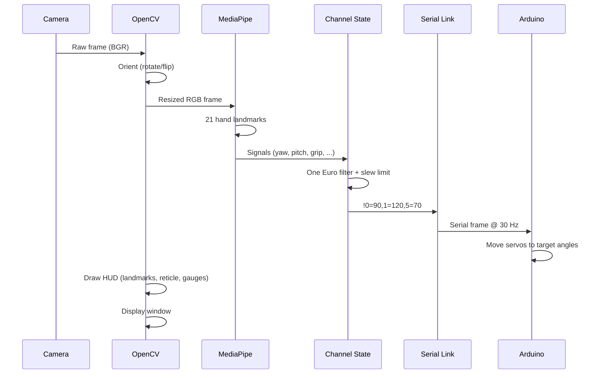

# Camo based Mobile Robotic Arm Pick and Place

A gesture-controlled 6-DOF robotic arm system that uses an overhead camera (Camo) and MediaPipe hand tracking to translate hand signals into servo commands sent over serial to an Arduino. Move your hand to position the claw, open/close your hand to grip, and watch the arm follow in real time with a sci-fi HUD overlay.

---

## Table of Contents

- [Overview](#overview)
- [Features](#features)
- [Hardware Requirements](#hardware-requirements)
- [Software Dependencies](#software-dependencies)
- [System Architecture](#system-architecture)
- [Data Flow](#data-flow)
- [Configuration Reference](#configuration-reference)
- [Hand Signals to Servo Mapping](#hand-signals-to-servo-mapping)
- [Installation](#installation)
- [Usage](#usage)
- [Keyboard Controls](#keyboard-controls)
- [Tuning Guide](#tuning-guide)
- [Troubleshooting](#troubleshooting)
- [License](#license)

---

## Overview

The **Camo based Mobile Robotic Arm Pick and Place** system enables intuitive, gesture-based control of a robotic arm using nothing but a webcam feed piped through [Camo](https://reincubate.com/camo/) (or any UVC camera) and [MediaPipe](https://mediapipe.dev/) hand landmarks.

Your hand becomes the controller:
- **Move your hand** left/right/forward/back → the base and shoulder servos follow
- **Open your hand** → claw opens
- **Make a fist** → claw closes
- **Press SPACE** → arm/disarm (safety toggle)

A real-time HUD overlays hand landmarks, a reticle at the palm position, servo gauges, a 5 cm scale bar, FPS counter, and link status directly on the camera feed.

---

## Features

| Feature | Description |
|---------|-------------|
| **Gesture Tracking** | MediaPipe 21-point hand landmark detection at ~30 FPS |
| **Real-time Control** | Hand motion mapped to servo angles with One Euro filtering |
| **Slew Rate Limiting** | Configurable max speed per channel protects gears and wiring |
| **Deadband Filtering** | Ignores micro-movements to eliminate servo buzz |
| **Safety Arm/Disarm** | SPACE bar toggles sending; disarmed = servos hold position |
| **Auto Port Detection** | Automatically finds Arduino/CH340/FTDI serial ports |
| **Dry-run Mode** | Run without serial hardware (HUD only) |
| **Live Tuning Window** | On-screen sliders for cutoff, beta, max-speed per channel |
| **Home Position** | Press `c` to set the current hand spot as the start/zero pose |
| **Orientation Controls** | Live flip/rotate adjustments for overhead camera mounting |

---

## Hardware Requirements

| Component | Recommended / Notes |
|-----------|---------------------|
| **Camera** | Any UVC webcam; Camo (iPhone/Android as webcam) works well |
| **Microcontroller** | Arduino Uno / Nano / Mega (or any board with CH340, CP210x, FTDI) |
| **Servos** | Up to 6 standard hobby servos (base, shoulder, elbow, claw, etc.) |
| **Power** | 5V 2A+ external supply recommended for servos (do not power from Arduino 5V pin under load) |
| **Computer** | macOS / Windows / Linux with Python 3.9–3.12 |

---

## Software Dependencies

| Package | Version | Purpose |
|---------|---------|---------|
| `mediapipe` | `0.10.21` | Hand landmark tracking |
| `opencv-contrib-python` | `4.11.x` | Camera capture, image processing, HUD rendering |
| `pyserial` | `3.5` | Serial communication with Arduino |
| `numpy` | `<2` | Array math for HUD geometry |
| `matplotlib` | `3.11.x` | Indirect dependency (mediapipe) |
| `jax`, `jaxlib` | `0.7.x` | MediaPipe backend |
| `protobuf` | `4.25.x` | MediaPipe model serialization |
| `absl-py`, `flatbuffers`, `pillow`, `scipy`, ... | — | Transitive MediaPipe dependencies |

> **Note:** `mediapipe` only ships wheels for Python 3.9–3.12. Python 3.13+ is **not** supported.

`pygrabber` is listed for Windows DirectShow device-name lookup. On macOS/Linux it is skipped gracefully; camera indices are probed instead.

---

## System Architecture

```mermaid
flowchart TD
    CAM[Overhead Camera Camo / Webcam] --> CAP[camera.py OpenCV VideoCapture]
    CAP --> ORIENT[orient() Rotate / Flip]
    ORIENT --> TRACK[tracker.py MediaPipe Hands]
    TRACK --> SIGNALS[Hand Signals yaw, pitch, grip, dx_cm, dy_cm, ...]
    SIGNALS --> CHANNELS[channels.py One Euro Filter + Slew Limit]
    CHANNELS --> ANGLES[Servo Angles 0–180° per channel]
    ANGLES --> LINK[link.py Serial ArmLink]
    LINK --> SERVO[Arduino Servo Control]
    TRACK --> HUD[hud.py Sci-fi Overlay]
    ORIENT --> HUD
    CHANNELS --> HUD
    LINK --> HUD
    HUD --> DISPLAY[Display Window OpenCV imshow]
    USER[(User)] -->|Hand Gestures| CAM
    USER -->|Keyboard| DISPLAY
    USER -->|c: set home| TRACK
    USER -->|SPACE: arm/disarm| CHANNELS
```

---

## Data Flow



---

## Configuration Reference

All tunables live in `config.py`. Edit values there, or tune live with the on-screen sliders (`p` to print values).

| Section | Key | Type | Default | Description |
|---------|-----|------|---------|-------------|
| Hardware | `SERIAL_PORT` | str | `"auto"` | Arduino port or `"auto"` to detect |
| Hardware | `BAUD` | int | `115200` | Serial baud rate |
| Hardware | `SEND_HZ` | int | `30` | Max frames/sec sent to Arduino |
| Hardware | `KEEPALIVE_S` | float | `0.5` | Resend unchanged angles this often |
| Camera | `CAMERA` | str | `"Camo"` | Device name substring or index |
| Camera | `CAM_WIDTH` | int | `1280` | Capture width |
| Camera | `CAM_HEIGHT` | int | `720` | Capture height |
| Camera | `CAM_BACKEND` | str | `"msmf"` | Windows backend: `msmf`, `dshow`, `any` |
| Orientation | `ROTATE` | int | `90` | 0, 90, 180, 270 clockwise |
| Orientation | `FLIP_H` | bool | `False` | Horizontal flip |
| Orientation | `FLIP_V` | bool | `False` | Vertical flip |
| Tracking | `MODEL_COMPLEXITY` | int | `1` | 0 = faster, 1 = more accurate |
| Tracking | `TRACK_WIDTH` | int | `640` | Downscaled width for tracking |
| Tracking | `DETECT_CONF` | float | `0.6` | Min detection confidence |
| Tracking | `TRACK_CONF` | float | `0.5` | Min tracking confidence |
| Zone | `ZONE` | tuple | `(0.15, 0.10, 0.85, 0.90)` | Working zone (x0, y0, x1, y1) normalized |
| Grip | `FINGER_EXTENDED_RATIO` | float | `1.15` | Finger extended threshold |
| Grip | `OPEN_MIN_FINGERS` | int | `3` | ≥ this = open hand |
| Grip | `CLOSED_MAX_FINGERS` | int | `1` | ≤ this = fist |
| Grip | `GRIP_DEBOUNCE_FRAMES` | int | `3` | Frames a grip state must hold |
| Scale | `PALM_CM` | float | `9.0` | Your wrist-to-knuckle length in cm |
| Scale | `SCALE_SMOOTH_S` | float | `1.5` | Scale smoothing time constant |
| Arm | `ARM_REACH_CM` | float | `20.0` | Base axis → claw tip horizontal |
| Arm | `SHOULDER_TO_TIP_CM` | float | `25.0` | Shoulder pivot → claw tip |
| Motion | `MOTION_SCALE` | float | `1.0` | 1.0 = 1:1 hand-to-claw movement |
| Home | `HOME` | tuple | `(0.5, 0.6)` | Normalized home position |
| UI | `SHOW_TUNING_WINDOW` | bool | `True` | Show live tuning sliders |

---

## Hand Signals to Servo Mapping

Three channels are configured by default in `config.py`:

| Servo | Channel | Signal | Range | Start | Mapping |
|-------|---------|--------|-------|-------|---------|
| 0 | `base` | `yaw` | 0–180° | 90° | `angle = 90 + (−1.0 × yaw)` |
| 1 | `shoulder` | `pitch` | 30–180° | 90° | `angle = 90 + (1.0 × pitch)` |
| 5 | `claw` | `grip` | 70→25° | 70° | Stretched: open=70, fist=25 |

**Signal definitions:**

| Signal | Range | Meaning |
|--------|-------|---------|
| `yaw` | degrees | Base rotation so claw tip follows sideways hand move |
| `pitch` | degrees | Shoulder swing so claw tip follows forward/back hand move |
| `dx_cm`, `dy_cm` | cm | Hand offset from HOME in real-world cm |
| `grip` | 0.0 / 1.0 | 0 = open hand, 1 = fist (debounced) |
| `roll` | degrees | Hand rotation (0 = fingers pointing up) |
| `lr`, `far` | 0.0–1.0 | Position inside ZONE box |

Add new channels in `config.py` by appending a `Channel(...)` entry and adding the corresponding signal name in `tracker.py`.

---

## Installation

### 1. Clone / Create the Project

```bash
# Navigate to your workspace
cd /Users/darshsoni/Robo_Arm

# Create the project directory (already set up in this repo)
cd "Camo based Mobile Robotic Arm Pick and Place"
```

### 2. Create Virtual Environment (Python 3.9–3.12)

```bash
python3.11 -m venv .venv
```

> On macOS, the venv Python is at `.venv/bin/python`.  
> On Windows, it is at `.venv\Scripts\python.exe`.

### 3. Install Dependencies

```bash
# macOS / Linux
.venv/bin/python -m pip install -r requirements.txt

# Windows
.venv\Scripts\python -m pip install -r requirements.txt
```

The `requirements.txt` contains:

```text
mediapipe==0.10.21
pyserial==3.5
pygrabber==0.2
```

`pygrabber` is Windows-only (DirectShow). On macOS/Linux the code gracefully skips it and probes camera indices instead, so installation failure there is not critical.

---

## Usage

### Basic Run

```bash
# macOS / Linux
.venv/bin/python main.py

# Windows
.venv\Scripts\python main.py
```

### With Dry-run (No Arduino)

```bash
.venv/bin/python main.py --dry-run
```

### List Available Cameras

```bash
.venv/bin/python main.py --list-cameras
```

### Specific Camera and Port

```bash
.venv/bin/python main.py --camera 1 --port COM9
# or on macOS/Linux
.venv/bin/python main.py --camera 0 --port /dev/ttyUSB0
```

### First-Time Setup Steps

1. Connect your Arduino via USB.
2. Launch Camo (or your webcam software) so the camera feed is available.
3. Run `python main.py --list-cameras` to find your camera index.
4. Edit `config.py` if needed: set `CAMERA`, `ROTATE`, `FLIP_H`, `FLIP_V`.
5. Run `python main.py`.
6. Hold your hand up to the camera. You should see landmarks and a reticle.
7. Press **SPACE** to arm the arm; the servos will start moving.
8. Press **c** with your hand in position to set it as the home/zero pose.
9. Press **q** or **Esc** to quit.

---

## Keyboard Controls

| Key | Action |
|-----|--------|
| `q` / `Esc` | Quit the program |
| `SPACE` | Arm / Disarm (toggle sending servos) |
| `c` | Set current hand position as HOME |
| `f` | Toggle horizontal flip |
| `v` | Toggle vertical flip |
| `o` | Rotate camera 90° clockwise |
| `p` | Print tuning values to copy into `config.py` |

---

## Tuning Guide

Press **`p`** while running to print a block you can paste into `config.py`. The tuning window (if enabled) shows live sliders:

1. **Motion scale** (`MOTION_SCALE`): How far the claw moves relative to your hand. 1.0 = 1:1.
2. **Per-channel cutoff** (`min_cutoff`): Lower = steadier when still, more lag.
3. **Per-channel beta** (`beta`): Higher = less lag on fast movements.
4. **Per-channel max speed** (`max_speed`): Degrees/second slew limit; protects gears.

**Orientation workflow:**
1. Run with your overhead camera.
2. Use `f`, `v`, `o` until moving your hand RIGHT moves the reticle RIGHT, and moving it FARTHER moves it UP.
3. Press `p` and copy the printed `ROTATE`, `FLIP_H`, `FLIP_V` values into `config.py`.

---

## Troubleshooting

| Problem | Likely Cause | Fix |
|---------|--------------|-----|
| `Could not open camera` | Camera index/name wrong, or Camo not running | Run `--list-cameras`; verify Camo app is active |
| `No Arduino serial port found` | Arduino not connected, or wrong VID | Check `ls /dev/tty.*` (macOS) or Device Manager (Windows); set `SERIAL_PORT` manually |
| `Port busy` | Arduino IDE Serial Monitor holding port | Close Arduino IDE / Serial Monitor; the program auto-retries |
| Servos jitter / buzz | `deadband` too low, or `max_speed` too high | Increase `deadband` to 1.0–2.0, lower `max_speed` |
| No hand detected | Poor lighting, hand out of frame | Improve lighting; keep hand fully in view |
| Mediapipe import fails | Python version too new (3.13+) | Use Python 3.9–3.12 |
| `pygrabber` install fails | macOS/Linux (Windows-only package) | Safe to ignore; camera index probing is used instead |

---

## Project Structure

```
Camo based Mobile Robotic Arm Pick and Place/
├── README.md           # This file
├── main.py             # Entry point: camera → tracking → HUD → serial
├── camera.py           # Camera open/list/orient helpers
├── tracker.py          # MediaPipe hand tracking → named signals
├── channels.py         # Signal → angle: One Euro filter + slew limit
├── link.py             # Serial link to Arduino (auto port detection)
├── hud.py              # Sci-fi HUD overlay drawing
├── config.py           # All tunables: hardware, tracking, channels, UI
└── requirements.txt    # Python dependencies
```

---

## License

This project is provided as-is for educational and hobbyist use. Modify `config.py` to match your arm geometry, servo layout, and camera mounting.
| **Serial Cable** | USB-A to USB-B (or USB-C) for Arduino connection |